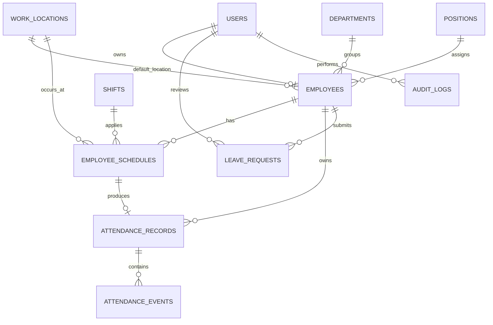

# Arsitektur Sistem

```mermaid
flowchart LR
    U[Browser Pegawai/Admin] --> L[/login]
    L --> R{Role}
    R -->|employee| EP[Portal /pegawai]
    R -->|admin| AP[Panel /admin]
    EP --> EM[auth + role:employee]
    AP --> AM[auth + role:admin]
    EM --> EC[Employee Controllers]
    AM --> AC[Admin Controllers]
    EC --> AS[Attendance Service]
    AS --> GS[Geofence Service]
    AS --> PS[Private Storage]
    AS --> DB[(MySQL/MariaDB)]
    AC --> DB
    AC --> PS
    AS --> AU[Audit Service]
    AC --> AU
    AU --> DB
```

## ERD Ringkas



## Keputusan Desain

- Session authentication dipakai karena frontend dan backend berada pada aplikasi Laravel yang sama.
- Login digabung, tetapi route bisnis dipisahkan agar role tidak bergantung pada menu frontend.
- `attendance_records` menyimpan rekap per tanggal; `attendance_events` menyimpan bukti masuk/pulang.
- Foto dan lampiran memakai disk `local`, bukan `public`.
- Jarak dihitung dengan Haversine agar MySQL Laragon dapat digunakan tanpa PostGIS.
- Database transaction, row lock, dan unique index digunakan bersama untuk mencegah duplikasi.
- Audit log menyimpan perubahan penting tanpa menyimpan password.

## Boundary Keamanan

Frontend hanya mengumpulkan selfie, koordinat, akurasi, dan waktu perangkat. Backend selalu membaca jadwal, shift, lokasi, radius, status akun, dan waktu resmi dari server/database.
